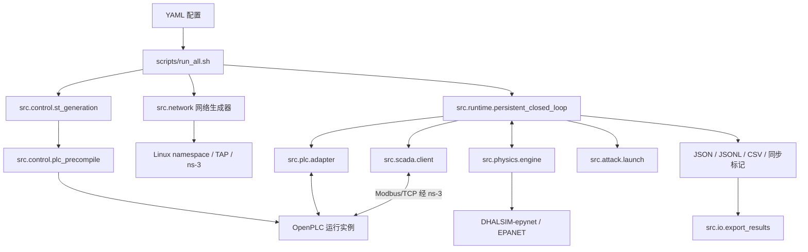

# Hydro-CPS-Sim V1.0 软件架构

## 模块与调用关系

简洁模式由 `src/run/progress.py` 启动运行脚本，读取阶段和周期完成消息，更新终端进度并保存完整日志。

`run_all.sh` 依次读取配置、检查依赖和权限、准备运行目录、生成 ST 与网络代码、编译 PLC 和 ns-3 程序、创建网络命名空间、启动组件、执行闭环仿真并导出结果。网络脚本创建 Linux 网络设备，生成的 C++ 程序建立 ns-3 网络，两者通过 TAP 交换数据。

## 闭环时序

`persistent_closed_loop.py` 将 `physics_0000` 保存为零值占位记录，控制过程从 `physics_0001` 开始。该初始状态取自配置，压力和流量使用零值。每个控制周期 k 按以下顺序执行：

1. PLC 适配器将 `physics_k` 的本地传感数据写入 PLC 寄存器。
2. SCADA 轮询 PLC，将远端控制依赖下发到相应 PLC。
3. 等待 `logic_wait` 后读 PLC 输出线圈，合并为 `actuator_state_k`。
4. 物理适配层将执行器状态应用到水力引擎，发布 `physics_(k+1)`。

`src/sync/filesystem.py` 通过文件标记协调进程，`src/comm/modbus.py` 提供 Modbus 通信接口。寄存器地址由生成 ST 的 `%MD` 和 `%QX` 声明解析得到。水力步长表示模型推进的时间，运行耗时表示计算机实际执行所用的时间。

## 组件边界

`src/physics/engine.py` 调用外部水力引擎并转换状态数据；`src/control/` 生成 ST 并调用 OpenPLC 编译工具；`src/network/` 生成 ns-3 拓扑代码。EPANET 求解器、OpenPLC 编译器和 ns-3 内核由外部依赖提供。水力初始化及 `next-run` 等推进顺序由配置确定。
