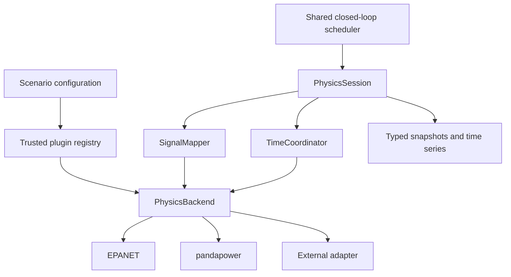

# Unified Physical Simulation Interface

UPSI connects a physical simulator to the existing OpenPLC, SCADA, Modbus, ns-3 and attack loop. The scheduler exchanges typed signals and requests physical time through one interface. Simulator APIs, model ports and numerical methods stay inside adapters.

The current framework runs one physical backend per scenario. EPANET, pandapower and the independent [thermal box](../examples/thermal_box/README.md) adapter all use this path.



## Backend contract

Implement `PhysicsBackend` from `src.physics.base`:

```python
class PhysicsBackend:
    def describe(self) -> dict: ...
    def initialize(self) -> StepResult: ...
    def advance(self, until_s: float, inputs: Mapping[str, Scalar]) -> StepResult: ...
    def close(self) -> None: ...
```

`describe()` returns native ports as `SignalSpec` objects, time capability (`target` or `event_step`) and a model description. Callers can inspect it before initialization. Constructors load configuration without acquiring solver resources.

`initialize()` returns the initial state. Repeated calls must not reset the simulator. `advance()` applies inputs at the current physical time and advances toward an absolute target in seconds. `close()` releases resources and is safe before initialization, after a failure and when called repeatedly.

`StepResult` carries `time_s`, `outputs`, `applied_inputs`, `status`, `diagnostics`, per-output `quality` and measurement `timestamps`. Outputs and applied inputs must match the described ports exactly. Missing measurements, nonfinite numbers, stale timestamps and failed status stop the run. A failed step never produces a new successful snapshot; `runtime/raw/physics_errors.jsonl` records the error, requested time, last valid time and a separate UTC wall-clock timestamp.

## Scene schema

New scenarios use `schema_version: 2`. Network topology, PLC ownership, control rules and attacks retain their existing configuration format.

```yaml
schema_version: 2
physics:
  backend: thermal_box
  plugins:
    thermal_box:
      factory: examples.thermal_box.adapter:ThermalBackend
  model:
    path: model.yaml
  timing:
    mode: fixed_step
    step_seconds: 1.0
  signals:
    observations:
      TEMPERATURE: {port: box.temperature}
      HEATER_POWER: {port: box.heater_power}
    commands:
      HEATER: {port: heater.enabled}
signals:
  TEMPERATURE: {direction: output, dtype: float, unit: degC}
  HEATER_POWER: {direction: output, dtype: float, unit: W, minimum: 0}
  HEATER: {direction: input, dtype: bool, unit: '1'}
actuators:
  - {name: HEATER, initial_state: false}
```

Model paths are relative to the scene file. Each adapter interprets its own `model` parameters and native `port` strings. The framework never infers physical meaning from signal names. Metadata may be declared under top-level `signals` or directly in a mapping; conflicting definitions are rejected. Every mapped v2 signal needs an explicit dtype. Units default to the adapter's described native unit when omitted.

`SignalSpec` supports `float`, `int`, `bool` and `str`, engineering units and optional numeric bounds. Booleans are distinct from integers. The physical API supports all four scalar types and analog commands. The current OpenPLC/Modbus binding accepts **float observations and BOOL commands**. Other types require their own explicit transport binding and are rejected before daemon launch; they are never silently coerced into coils or REAL registers.

## Signal mapping and units

For numeric signals, the mapping is:

```text
logical value = native port value × scale + offset
```

Observation mapping uses this transformation; commands use its inverse. For example, a native Celsius measurement can expose Kelvin through `unit: K, offset: 273.15`, and a native W input can expose kW through `unit: kW, scale: 0.001`. A unit change requires an explicit transform; the framework does not guess conversions from names or unit strings. Affine transformations require floats. Boolean mappings may use `invert: true`.

The mapper validates dtype, direction, bounds, port existence and complete input coverage. Two command signals cannot write the same native port. A PLC sensor must have a mapped output. Backend failures and invalid observations stop the session, invalidate it and release the backend.

Solved outputs have `quality: good`, or an adapter-defined supported condition such as `unsupplied` with an explicit value policy. Historical configured initialization rows have `quality: initial` and `valid: false`. Such rows cannot be returned as solved outputs from `advance()`.

## Time coordination

`TimeCoordinator` computes a target from the last granted physical time and `step_seconds`. Inputs take effect at the previous grant, and output timestamps equal the newly granted time. Snapshots record `input_effective_time_s`, `requested_time_s` and `granted_time_s`.

A `target` backend must reach the requested time. Pandapower solves a quasi-static operating point at that sample; the thermal adapter integrates its ODE analytically over the interval. EPANET advertises `event_step`: its next hydraulic event may occur before the requested bound. The coordinator accepts that actual time and uses it for the next request. Stalled, backward, overshooting or nonfinite grants fail. Cycle numbers and PLC scan/wall-clock delays never define physical time.

## Plugins

The registry imports only the selected backend. Built-in registrations carry solver dependencies, default initialization policy and time capabilities. Third-party factories are declared in the scene as explicit `module:class` sources or named installed entry points in `hydro_cps.physics`. No adapter-specific branch is added to the scheduler or runner, and installed plugins are not automatically activated.

Plugin configuration is trusted code: importing a configured Python adapter executes that package. Use explicit factories or named entry points from packages you trust. Duplicate names, replacement of built-ins and unknown backends are rejected. See the [adapter SDK](adapter-sdk.md) for implementation and packaging.

## Existing C-Town and power scenarios

Legacy YAML continues to load. `normalization.py` translates its physical configuration into the standard model/timing/signal structure. C-Town naming rules, `inp_file`, `initial_tank_values`, historical zero/configured rows and event stepping are handled by `physics/legacy/ctown_compat.py` and the unchanged historical engine in `physics/legacy/epanet_engine.py`.

`src.physics.engine.PhysicsEngine`, the old step adapters and `src.io.dhalsim` remain compatibility imports for existing Python callers. New integrations use `PhysicsBackend` and `PhysicsSession`.

The old `physics.csv` layout remains available through `io/legacy_export.py`. Generic exports never derive flow from a name ending in `F`, invent zero values for missing measurements or assume tank-style SCADA variable names. The existing [power scenarios](../examples/power_feeder/README.md) also run through UPSI; [config_v2.yaml](../examples/power_feeder/config_v2.yaml) shows the explicit schema.

## Results

- `runtime/json/physics_*.json`: values, logical commands, physical times, validity, quality, units/types and diagnostics.
- `runtime/json/signal_schema.json` and `reports/signal_schema.json`: adapter/model identity, timing and logical/native signal descriptions.
- `reports/csv/physics_state.csv`: wide physical states and time/backend/status metadata.
- `reports/csv/physics_signals.csv`: one signal per row, including direction, dtype, unit, quality, validity, measurement time and input effective time.
- `reports/csv/physics.csv`: historical flat compatibility view.
- `runtime/raw/physics_errors.jsonl`: failed initialization/advancement diagnostics, with no successful replacement state.

Model scope and actual acceptance results are recorded in [UPSI validation](upsi-validation.md).

## Next extensions

FMI/FMU support and multiple simultaneous backends are P5 work. They are not implemented here. An FMU adapter will need FMI version/platform/capability checks, while multi-backend operation needs time negotiation and coupling rules beyond the current single-backend coordinator.
